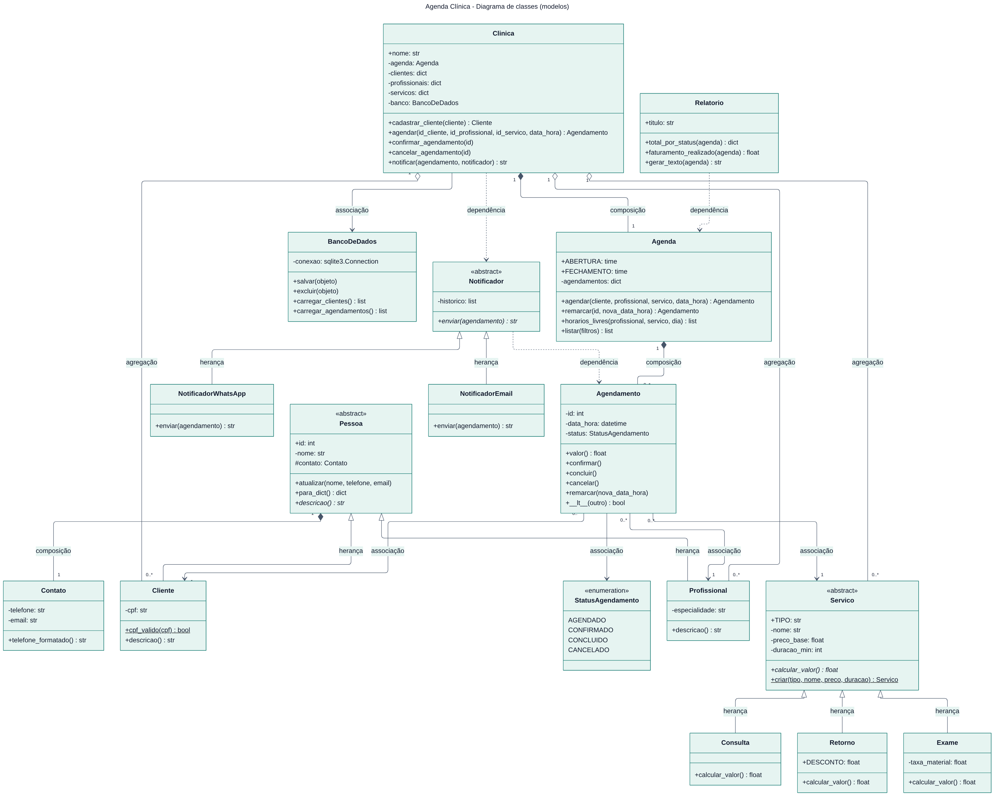

# Agenda Clínica — sistema de agendamento em Python (Orientação a Objetos)

Aplicativo desktop para agendar clientes e pacientes de uma clínica ou de qualquer empresa que trabalhe com horário marcado. Projeto da disciplina de Orientação a Objetos.

- Cadastro completo (incluir, listar, pesquisar, editar e excluir) de **clientes**, **profissionais** e **serviços**
- **Agenda** com horário de funcionamento, bloqueio de conflitos e sugestão de horários livres
- Confirmar, concluir, cancelar e remarcar atendimentos
- Aviso ao cliente por **WhatsApp** ou **e-mail** (envio simulado)
- **Relatório** de faturamento e de desempenho por profissional, com exportação em .txt
- **Banco de dados SQLite**: tudo fica salvo no arquivo `agenda.db`
- **Menu no terminal** e **interface gráfica** (Tkinter com estilos personalizados)
- **97 testes automatizados** com `unittest`

## Como executar

Precisa só do Python 3.8 ou mais novo. Nenhuma biblioteca extra é necessária.

```bash
python main.py              # interface gráfica (janelas)
python main_terminal.py     # menu no terminal
python -m unittest -v       # roda todos os testes
```

Na primeira execução, o banco `agenda.db` é criado com dados de exemplo. Para recomeçar do zero, apague esse arquivo.

## Diagrama UML



Também há o diagrama da interface e das exceções em [`docs/diagrama_interface.png`](docs/diagrama_interface.png). O código-fonte dos dois diagramas (Mermaid) está em `docs/*.mmd`.

## Conceitos de OO e onde estão

| Conceito | Onde está no código |
| --- | --- |
| Classe abstrata | `Pessoa`, `Servico`, `Notificador` (pasta `modelos/`) e `AbaCadastro` (`interface/abas.py`) |
| Herança | `Cliente` e `Profissional` herdam de `Pessoa`; `Consulta`, `Exame` e `Retorno` de `Servico`; `NotificadorWhatsApp` e `NotificadorEmail` de `Notificador`; exceções de `AgendaErro`; `JanelaPrincipal` de `tk.Tk` |
| Polimorfismo | `calcular_valor()`, `descricao()`, `enviar()`, `para_dict()` e `atualizar()` sobrescritos; `aba.atualizar()` em todas as abas; `except AgendaErro` trata qualquer erro do sistema |
| Encapsulamento | atributos privados (`__nome`, `__cpf`...) com `@property` e validação; o status do agendamento só muda pelos métodos `confirmar()`, `concluir()`, `cancelar()` e `remarcar()` |
| Composição | `Pessoa` ◆ `Contato`; `Clinica` ◆ `Agenda`; `Agenda` ◆ `Agendamento` (as partes são criadas dentro do todo) |
| Agregação | `Clinica` ◇ `Cliente`, `Profissional` e `Servico` (criados fora e depois cadastrados) |
| Associação | `Agendamento` → `Cliente`, `Profissional` e `Servico`; `Clinica` → `BancoDeDados` |
| Dependência | `Clinica.notificar(agendamento, notificador)`, `Notificador.enviar(agendamento)` e `Relatorio.gerar_texto(agenda)` usam o objeto só como parâmetro |
| Sobrecarga de operadores | `Agendamento.__lt__` (ordenar por data) e `__str__`; `Agenda.__len__` e `__iter__` |
| Métodos estáticos e de classe | `Cliente.cpf_valido()`, `Servico.criar()` (fábrica) e `Tema.aplicar()` |
| Atributos de classe | `Servico.TIPO`, `Retorno.DESCONTO`, `Agenda.ABERTURA` e `Agenda.FECHAMENTO` |
| Exceções personalizadas | `modelos/excecoes.py` |

## Regras de negócio

- Atendimento das 08:00 às 18:00; não é possível agendar no passado.
- Um profissional ou cliente não pode ter dois horários sobrepostos (horários cancelados ou concluídos liberam a vaga).
- CPF validado pelos dígitos verificadores e sem repetição.
- Cliente, profissional ou serviço com agendamentos no histórico não pode ser excluído.
- Consulta cobra o preço base; Exame soma a taxa de material; Retorno tem 50% de desconto.

## Estrutura de pastas

```
ProjetoDesktop/
├── main.py              interface gráfica
├── main_terminal.py     menu no terminal
├── modelos/             classes de negócio (pessoa, serviço, agenda, clínica...)
├── banco/               banco SQLite e dados de exemplo
├── interface/           menu do terminal, janelas, abas e estilos
├── tests/               testes automatizados
└── docs/                diagramas UML
```

## Banco de dados (SQLite)

| Tabela | Colunas |
| --- | --- |
| `clientes` | id, nome, telefone, email, cpf (único) |
| `profissionais` | id, nome, telefone, email, especialidade |
| `servicos` | id, tipo, nome, preco_base, duracao_min, taxa_material |
| `agendamentos` | id, cliente_id, profissional_id, servico_id (chaves estrangeiras), data_hora, status, observacao |

## Níveis do trabalho

| Nível | O que é apresentado | Como |
| --- | --- | --- |
| 1 | Modelagem completa, UML e testes | `docs/diagrama_uml.png` e `python -m unittest -v` |
| 2 | Menu funcionando com todos os modelos | `python main_terminal.py` |
| 3 | Projeto completo com banco de dados | `python main_terminal.py` (a opção 6 mostra as tabelas) |
| 4 | Interface gráfica com janelas, botões e estilos | `python main.py` |
